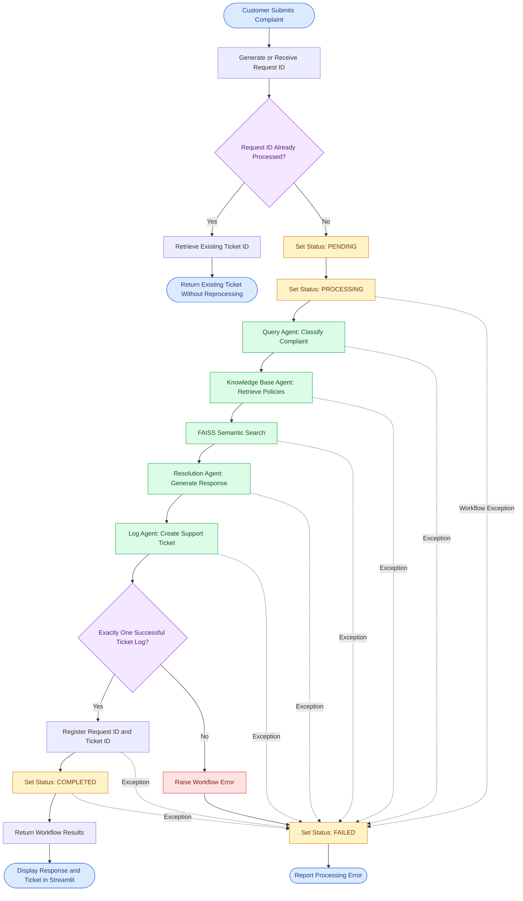

# MyCSA – Customer Complaint Processing Workflow

This diagram illustrates how MyCSA processes customer complaints using AutoGen SelectorGroupChat, FAISS, and request tracking.

## Workflow Diagram

## Workflow Explanation

### 1. Request Initialization

When a customer submits a complaint, MyCSA generates a unique request ID.

The workflow can also accept an existing request ID supplied programmatically.

### 2. Idempotency Verification

The workflow checks whether the request ID is already registered.

If the request ID has already been processed, the existing ticket ID is returned without running the agents again.

### 3. Request Status Tracking

New requests move through the following statuses:

**PENDING → PROCESSING → COMPLETED**

If an exception occurs during the protected workflow execution, the status changes to **FAILED**.

### 4. Multi-Agent Processing

The SelectorGroupChat coordinates four agents in sequence:

1. **Query Agent:** Classifies the complaint.
2. **Knowledge Base Agent:** Retrieves relevant company policies using FAISS.
3. **Resolution Agent:** Generates a policy-grounded customer response.
4. **Log Agent:** Creates the support ticket and applies escalation rules.

### 5. Ticket Validation

After the agents finish, MyCSA checks whether exactly one successful ticket logging event occurred.

A successful result allows the request ID and ticket ID to be registered.

### 6. Workflow Completion

The request status is updated to COMPLETED.

The workflow results are returned to Streamlit, which displays the response and ticket information.

### 7. Error Handling

Exceptions during the protected workflow execution are recorded with a FAILED status and propagated to the calling application.

**Note:** This diagram represents the main processing flow. Initialization failures occurring before the workflow's exception handler are outside the illustrated FAILED-status handling path.

---
