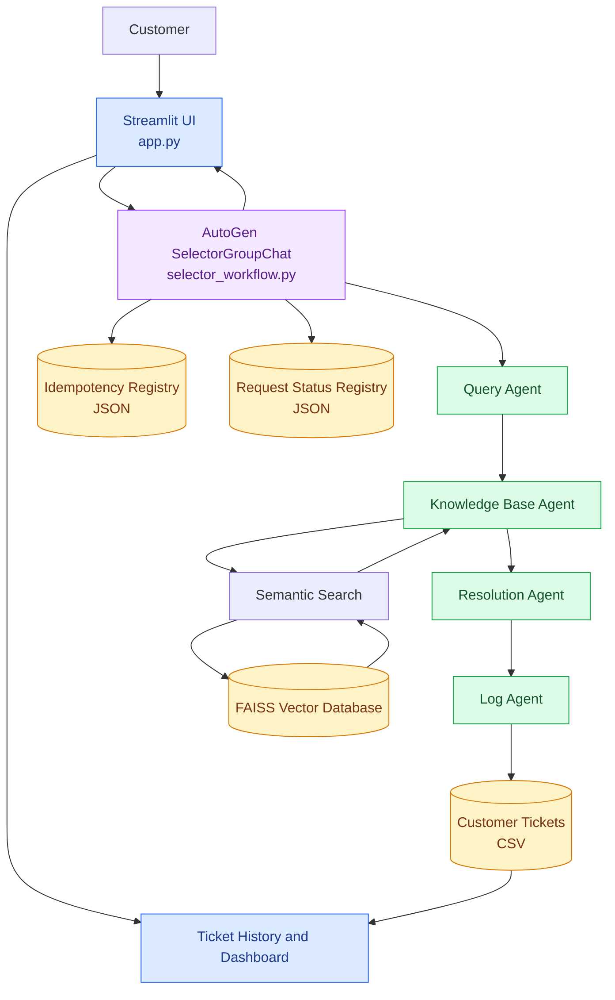

# MyCSA – System Architecture

The following diagram illustrates the major components of the MyCSA customer support automation application.

## Architecture Description

The customer submits a complaint through the Streamlit interface.

The SelectorGroupChat workflow coordinates four specialized agents:

1. The Query Agent classifies the complaint.
2. The Knowledge Base Agent retrieves relevant company policies using FAISS.
3. The Resolution Agent generates a policy-grounded response.
4. The Log Agent creates a support ticket and applies escalation rules.

The workflow also maintains request status information and an idempotency registry.

After processing, Streamlit displays the customer support response, ticket details, and available knowledge sources.

The dashboard reads stored ticket information to display ticket history and analytics.
